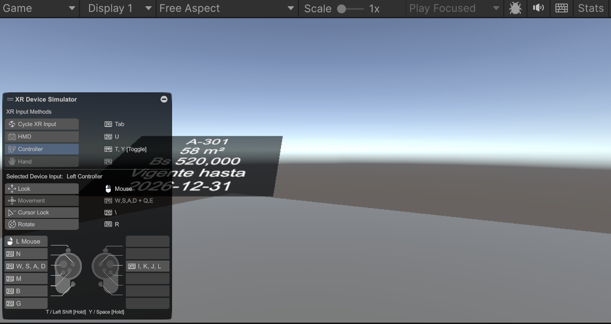

# UMBRAL VR: informe de avance

Sala de ventas inmersiva en realidad virtual para departamentos en preventa (Meta Quest 3/3S).
Repositorio: https://github.com/andredellien/umbral-vr

## Qué se logró

### Servidor (`server/`)
- API en NestJS 11 con dos endpoints: `GET /health` y `GET /catalog`.
- El catálogo se sirve desde `server/seed/catalog.json` (unidades, acabados y precios en bolivianos).
- Integración continua en verde: instala, compila y pasa sus 4 pruebas automáticas.

### Cliente (`client/`)
- Proyecto Unity 6 (6000.6.8f1) con URP, OpenXR, XR Interaction Toolkit 3.7 y soporte Meta Quest.
- Lógica del negocio aislada en `Umbral.Core` (C# puro, sin dependencias de Unity):
    - precio = base de la unidad + diferencias de acabados, en bolivianos enteros;
    - consultas sobre el catálogo.
- Red y caché (`Umbral.Net`): el catálogo carga desde el servidor, luego caché en disco y, como último recurso, un catálogo incluido en la app. Funciona con el servidor apagado.
- **Escena de arranque (`Boot`)**: un panel anclado a la muñeca izquierda muestra la unidad A-301, su área (58 m²), su precio (Bs 520,000) y la vigencia del catálogo. Muestra lo mismo con el servidor apagado.
- **Configuración para Quest**: IL2CPP, ARM64, Android 10+ (API 29), OpenXR con Meta Quest Support y perfiles de controles. Se genera un instalable (APK) por línea de comandos.
- **Pruebas sin visor**: simulador de dispositivo XR integrado al editor (solo en desarrollo, no viaja en el instalable). Permite probar la escena con teclado y mouse.
- 10 pruebas EditMode y 1 prueba PlayMode, todas aprobadas.

### Ingeniería
- Repositorio público en GitHub, trabajo en `main` siempre desplegable.
- Flujos de integración continua para servidor y cliente.
- Documentación: diseño del juego (GDD), plan por semanas, decisiones de arquitectura y este informe.

## Estado de verificación
| Componente | Resultado |
|---|---|
| Servidor: instalación, compilación y pruebas | 4 de 4 |
| Cliente: pruebas EditMode | 10 de 10 |
| Cliente: prueba PlayMode (escena Boot sin servidor) | 1 de 1 |
| Cliente: compilación del APK para Quest | OK |
| Cliente: prueba visual en simulador | OK |
| Cliente: prueba en visor real | Pendiente (sin visor) |

## Riesgos y limitaciones
- El visor Quest estará disponible al final del semestre. Hasta entonces no se pueden medir fps reales ni validar comodidad VR (mareo, escala de la interfaz en la muñeca). Se mitiga con el simulador, pruebas automáticas y medición del presupuesto de la escena en el editor.
- La integración continua del cliente requiere resolver la activación de licencia de Unity en GitHub Actions.

## Siguiente
1. Spike de presupuesto de escena (100 draw calls y 500k triángulos) medido en el editor.
2. Spike del reloj solar con 4 sets de lightmaps.
3. Despliegue del servidor a un entorno de pruebas.
4. Resolver la licencia de Unity para la integración continua del cliente.
