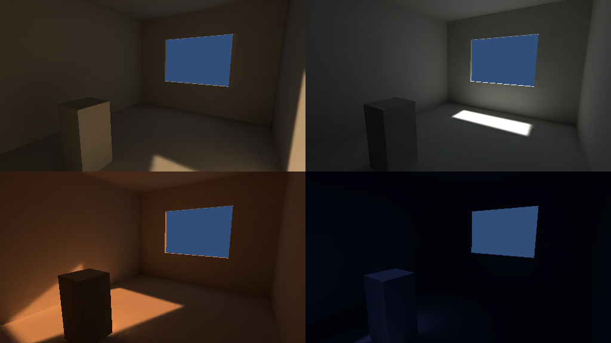

# Spike: reloj solar con lightmaps horneados

Objetivo (ADR-001 #5 y `SEMANA-1.md`): comprobar que cuatro momentos del día pueden cambiarse en runtime usando luz horneada, sin iluminación en tiempo real.

## Qué se construyó
- Cuarto de prueba (5 × 3 × 4 m) con una ventana, generado por `Umbral > Build Solar Spike` (`SolarSpikeBuilder`).
- Cuatro hornees con el mismo cuarto y distinto sol: mañana, mediodía, tarde y noche. Cada uno se guarda como un `LightmapSet` (3 texturas).
- `SolarClock` cambia entre sets asignando `LightmapSettings.lightmaps`. Es el mecanismo real que usará el reloj de la muñeca.
- Prueba `SolarClockTests` (categoría `Spike`): cambia entre las 4 paradas, renderiza cada una y verifica que las cuatro se ven distintas entre sí y que la noche es la más oscura.

## Resultados (Mac, Apple M1 Pro, editor)
| Parada | Brillo medio | Lightmaps en memoria | Cambio de set |
|---|---|---|---|
| Mañana | 0.165 | 1.5 MB | < 1 ms |
| Mediodía | 0.204 | 1.5 MB | < 1 ms |
| Tarde | 0.171 | 1.5 MB | < 1 ms |
| Noche | 0.033 | 1.5 MB | < 1 ms |

Horneado de las 4 paradas: unos 2.5 minutos en este cuarto con el lightmapper por GPU.

## Conclusión
El mecanismo funciona: el cambio es instantáneo y la luz cambia de verdad. Para el prototipo conviene **fundido a negro entre paradas** (compartiendo el componente de fundido del teletransporte) en vez de mezcla continua: URP no mezcla lightmaps de forma nativa, y mezclar exigiría un shader propio.

## Lo que falta antes de darlo por cerrado
- **Memoria real.** 1.5 MB por set es de un cuarto minúsculo. Un departamento completo usará varios lightmaps de 1024–2048; con 4 paradas hay que multiplicar por 4 y medir en el Quest, donde los lightmaps van comprimidos (ASTC).
- **Un solo juego cargado a la vez.** Se debe evitar tener los 4 sets en memoria a la vez (Addressables) si el presupuesto no alcanza.
- **Geometría estática.** Los sets solo valen mientras la geometría y los índices de lightmap no cambien entre hornees. Cada cambio de modelo obliga a rehornear las 4 paradas.
- **Objetos dinámicos** (muebles que el comprador mueva o cambie) no reciben esta luz horneada; necesitarán light probes. No se probó.
- **Fps en el Quest:** no medidos (sin visor).
